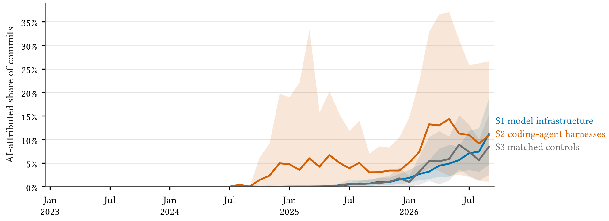

<p align="center"></p>

<h1 align="center">coauthored</h1>

[](https://github.com/thanatchon36/coauthored/actions/workflows/ci.yml)
[](LICENSE)
[](LICENSE-DATA)
[](STATUS.md)
[](PREREGISTRATION.md)

📄 **[Read the paper on the web](https://thanatchon36.github.io/coauthored/paper/)** ·
⬇️ **[Download the PDF](paper/coauthored.pdf)** ·
📈 **[Monthly dashboard](https://thanatchon36.github.io/coauthored/dashboard/)** ·
📊 **[Figures](results/figures/)** · 🧾 **[Pre-registration](PREREGISTRATION.md)** ·
🔀 **[Deviations](DEVIATIONS.md)** · 🔁 **[Reproduce](REPRODUCE.md)** · ⚖️ **[Responsible use](RESPONSIBLE_USE.md)**

**How Much of the Code That Trains the Models Declares AI Help? AI Co-Authorship Trailers in AI Infrastructure
Repositories, 2023–2026.** `coauthored` counts the commits in a git history that carry an explicit AI attribution: a
`Co-authored-by:` trailer naming an AI tool, a commit by an AI-agent account, or a tool's generated-with marker.
The pre-registered study in this repository measures that share month by month in 42 open-source repositories that
train, fine-tune, evaluate and serve AI models (S1), 12 open-source coding-agent harnesses (S2), and 42 popular
non-AI repositories matched on stars, language and activity (S3), from the full history of all 96 read on one day.

> Independent personal research. Public data only. Does not represent the views of any employer or institution.

## Result

<p align="center"></p>

In July–September 2026, **8.7% of commits to AI-infrastructure repositories were AI-attributed** (95% CI
4.0–14.5%), about one in 11, up from 0.5% over 2025 and almost none in 2024. **Matched non-AI repositories were
at a similar level**, 7.1% (2.3–12.6%), and the coding-agent harnesses, which started earlier, were not clearly
ahead (10.3%, 1.6–23.7%). The intervals are too wide to tell the groups apart: there is no evidence that "AI
building AI" runs ahead of popular open source, and no proof that it does not.

| pre-registered hypothesis | result |
|---|---|
| H1 S1 share in 2026-Q3 ≥ 5% | supported on the point estimate (8.7%); the CI reaches 4.0% |
| H2 S1 above S3 every month, odds ratio ≥ 2 | not supported (OR 1.24, CI 0.45–4.75) |
| H3 S1 steeper than S3 | not supported (slope difference 0.025 logit/month, CI −0.080 to 0.077) |
| H4 harnesses above S1 | not supported (+1.6 points, CI −9.0 to 15.8) |
| H5 Claude Code the top tool every quarter from 2025-Q2 | not supported (it leads only from 2026-Q1) |
| H6 ≥ 80% of attributed pull requests keep attribution after merge | **supported** (184 of 200, 92%) |
| H7 disclosure policies, higher share (exploratory) | positive (+2.9 points), confounded |

Every share is a **lower bound** on AI involvement, and an attributed commit is not a commit "written by AI":
the trailer says a tool took part, not how much of the change it produced. Attribution is not adoption either:
it can be switched off, lost at merge (rarely, in this sample), dropped when code is exported from an internal
monorepo, or never added. The review of the draft and how each point was handled are in
[docs/review.md](docs/review.md).

## Run it on your own organisation

```bash
uv tool install git+https://github.com/thanatchon36/coauthored   # or: pip install git+https://github.com/thanatchon36/coauthored
coauthored report --org <your-org>        # monthly AI-attributed share of every public repository since 2024-01
```

It lists the organisation's repositories with the GitHub CLI (`gh`, logged in), clones them with commit objects
only, needs no paid service or API key, and prints repository-level aggregates. Read
[RESPONSIBLE_USE.md](RESPONSIBLE_USE.md) before you publish anything: this measures projects, not people.

## Reproduce the paper

```bash
uv sync --all-extras
uv run coauthored analyze --draws 2000   # every table, figure and number, from committed aggregates, no network
uv run coauthored paper                  # PDF and web page (needs pandoc and typst)
```

`analyze` is byte-reproducible. The paper build fills every number from `results/numbers.json` and refuses
numbers typed by hand. [REPRODUCE.md](REPRODUCE.md) covers re-scanning the repositories and redrawing the
survival sample.

## What is here

| path | content |
|---|---|
| `src/coauthored/` | scanner, signature matcher, aggregation, analysis, paper and dashboard builders |
| `configs/` | frozen signature catalogue (52 entries, 28 tools, three public evidence commits each), bot list, repository lists |
| `data/` | snapshot manifest (head SHAs), repository-month aggregates, survival, size and policy samples |
| `results/` | `numbers.json`, tables, figures |
| `paper/` | paper source, PDF, template |
| `docs/` | phase reports, policy review, label sample, web paper and dashboard |

As pre-registered, only aggregates are released: no per-commit records, and the survival and size samples carry
no PR numbers or commit SHAs. The Hugging Face dataset is built by `scripts/build_hf_dataset.py`.

## Citation

See [CITATION.cff](CITATION.cff).

## License

Code: [Apache-2.0](LICENSE). Data: [CC BY 4.0](LICENSE-DATA).
